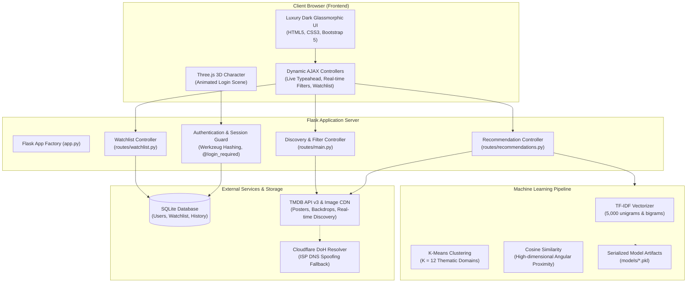

# CineMatch AI: Movie Recommendation System Using Clustering and Similarity-Based Machine Learning Techniques

**Academic Capstone / Final Year Machine Learning Project**  
**Technologies:** Python 3.14, Flask 3.1, Scikit-learn 1.9, Pandas, NumPy, SQLite, SQLAlchemy 2.0, Three.js, Bootstrap 5, TMDB API v3  

---

## 1. Abstract

Modern digital entertainment platforms host libraries comprising hundreds of thousands of media titles, generating an information overload dilemma where locating films tailored to distinct narrative, stylistic, and thematic preferences is challenging. 

**CineMatch AI** is a full-stack, production-grade Machine Learning Cinema Discovery and Recommendation platform. Built on the benchmark TMDB 5000 Movie Dataset, the platform implements an unsupervised machine learning pipeline featuring **TF-IDF (Term Frequency-Inverse Document Frequency) vectorization**, **K-Means clustering** ($K=12$ thematic clusters) for domain-guided search space pruning, and **Cosine Similarity** for high-dimensional angular proximity ranking.

To bridge academic machine learning with real-world streaming experiences, the system integrates a real-time **TMDB (The Movie Database) API v3** engine with automated DNS-over-HTTPS (DoH) resilience and in-memory TTL caching. The user interface features a luxury OTT dark glassmorphism design language (inspired by Netflix and Apple TV+), featuring real portrait movie posters, horizontal streaming carousels, an interactive multi-filter exploration engine (supporting Indian regional industries such as Tollywood, Bollywood, Kollywood, Mollywood, and international cinema), and a Three.js 3D character animation on the login gateway.

---

## 2. System Architecture



---

## 3. Key Features

### A. Luxury OTT Dark Glassmorphism Interface
- **Visual Style:** Deep charcoal, midnight navy, and pure black backgrounds (`#000000`, `#06080e`), ultra-thin translucent borders, subtle glowing cyan and electric-blue accents (`#00f0ff`, `#0070f3`), and crisp typography.
- **Real Portrait Posters:** All movie cards display high-resolution portrait posters (2:3 aspect ratio) with smooth hover zoom effects, rating badges, release years, and instant modal triggers.
- **Dynamic Horizontal Carousels:** OTT-style carousels with smooth scroll controls for:
  - *Trending Now*
  - *Latest Theatrical Releases*
  - *Tollywood Hits (Telugu Cinema)*
  - *Bollywood Hits (Hindi Cinema)*
  - *Kollywood Hits (Tamil Cinema)*
  - *Mollywood Hits (Malayalam Cinema)*
  - *Hollywood Blockbusters*
  - *Korean Cinema & K-Dramas*
  - *Anime & Cartoons*
  - *Top Rated Classics*
- **Live Search Autocomplete:** Instant debounced search bar with real-time poster thumbnails, release dates, and direct recommendation launchers.
- **Interactive Movie Details Modal:** Deep-dive modal presenting backdrop banners, high-res posters, cast badges, directorial credits, genre tags, synopses, and one-click Watchlist toggle.

### B. Real-Time Movie Discovery Hub (`/explore`)
A dedicated discovery page featuring multi-parameter filtering:
1. **Language Filter:** Real ISO 639-1 metadata support for Telugu, Hindi, Tamil, English, Malayalam, Kannada, Bengali, Marathi, Punjabi, Korean, Japanese, Chinese, French, Spanish, German, and Italian.
2. **Film Industry Mapping:**
   - **Indian Regional Cinema:** Tollywood (Telugu), Bollywood (Hindi), Kollywood (Tamil), Mollywood (Malayalam), Sandalwood (Kannada), Bengali, Marathi, and Punjabi.
   - **International Cinema:** Hollywood (English / US), Korean Cinema, Japanese Cinema, Chinese Cinema, French Cinema, Spanish Cinema.
   - **Animation Categories:** Animated Movies, Cartoons, Anime, Family Animation.
3. **Multi-Genre Chips:** Toggleable interactive chips (Action, Adventure, Animation, Comedy, Crime, Documentary, Drama, Family, Fantasy, History, Horror, Music, Mystery, Romance, Sci-Fi, Thriller, War, Western).
4. **Release Era Selector:** Classics (Before 2000), Golden Era (2000–2015), Modern Era (2016–2024), Latest (2025+), or custom release year.
5. **Sort Options:** Most Popular, Highest Rated, Latest Releases.

### C. Academic ML Recommendation Engine (Dual-Mode Architecture)
- **Local Dataset Mode (Academic ML):**
  - When the user selects a film within the benchmark TMDB 5,000 dataset, recommendations are generated through the TF-IDF + K-Means ($K=12$) + Cosine Similarity pipeline.
  - Returns the **Top 10 most similar films** within the target film's thematic cluster (with cluster backfilling if necessary).
  - Explicitly **excludes the query movie itself**.
  - Displays accurate **percentage similarity scores** (e.g., `87.4% Similarity`), cluster identity (`Cluster #2: Science Fiction`), and a detailed explanation of shared attributes (director, cast, genres, narrative themes).
  - Enriched with live TMDB poster artwork and backdrop images.
- **External Movie Mode (Academic Transparency Fallback):**
  - If a user searches for an external, newly released, or regional movie outside the local 4,800 dataset (e.g., *RRR*, *Kalki 2898 AD*, *Avatar: The Way of Water*), the system queries TMDB's similar graph.
  - Transparently labels the suggestions with an **"API Suggested"** badge and explicit disclaimer: *"Curated via TMDB's thematic similarity graph for live external films"*, upholding academic honesty by never falsely labeling API suggestions as machine learning computations.

### D. Production-Grade TMDB Integration & Network Resilience
- **Server-Side API Security:** The TMDB API key is managed securely in `.env` and `config.py`. It is never exposed in client HTML or JavaScript.
- **In-Memory TTL Caching:** Prevents rate-limiting and improves page load latency by caching API responses.
- **Automated DoH (DNS-over-HTTPS) Resolver:** Resolves regional ISP DNS timeouts (common with Indian ISPs such as Jio and Airtel) using Cloudflare DoH (`https://cloudflare-dns.com/dns-query`) and direct edge IP routing.
- **Graceful Zero-Network Fallback:** If internet access is completely disabled, the service automatically falls back to local dataset metadata without crashing.

---

## 4. Machine Learning Methodology & Formulas

### 1. Feature Preprocessing & Atomic Token Collapsing
In `ml/feature_engineering.py`, multi-word proper names are normalized by stripping spaces and converting to lowercase (e.g., `"Christopher Nolan"` $\to$ `"christophernolan"`, `"Christian Bale"` $\to$ `"christianbale"`). This ensures the vectorizer treats distinct entities as unified tokens.

A composite textual document (`tags`) is created for each film:
$$\text{tags} = \text{overview} + \text{tagline} + 2 \times \text{genres} + \text{keywords} + \text{cast} + 2 \times \text{director}$$

*(Double weighting on director and genres reinforces stylistic and directorial continuity).*

### 2. TF-IDF Feature Extraction
The Term Frequency-Inverse Document Frequency matrix transforms text into normalized mathematical vectors:
$$\text{TF}(t, d) = \frac{f_{t,d}}{\sum_{t' \in d} f_{t',d}}$$
$$\text{IDF}(t, D) = \log\left(\frac{N}{|\{d \in D : t \in d\}|}\right)$$
$$\text{TF-IDF}(t, d, D) = \text{TF}(t, d) \times \text{IDF}(t, D)$$

Configured with `TfidfVectorizer(max_features=5000, stop_words='english', ngram_range=(1, 2))`, generating a sparse matrix of dimension $(4800, 5000)$.

### 3. Unsupervised K-Means Clustering
The 4,800 movie vectors are partitioned into $K = 12$ thematic clusters (`random_state=42, n_init=10`), minimizing the within-cluster sum of squares (inertia):
$$J = \sum_{k=1}^{K} \sum_{x \in S_k} \| x - \mu_k \|^2$$

**Discovered Clusters:**
- **Cluster 0:** Horror & Supernatural Thrillers
- **Cluster 1:** Human Drama & Biography
- **Cluster 2:** Science Fiction & Space Adventure
- **Cluster 3:** Family & Animation
- **Cluster 4:** Romantic Comedy
- **Cluster 5:** Comedy & Satire
- **Cluster 6:** Crime & Detective Thrillers
- **Cluster 7:** Mystery & Psychological Suspense
- **Cluster 8:** Romantic Drama & Period Pieces
- **Cluster 9:** Music & Musical Performance
- **Cluster 10:** High-Octane Action & Adventure
- **Cluster 11:** War & Historical Epics

### 4. Cosine Similarity Metric
Pairwise angular proximity between the target movie vector $\mathbf{u}_A$ and candidate vectors $\mathbf{u}_B$ is computed:
$$\text{Cosine Similarity}(\mathbf{u}_A, \mathbf{u}_B) = \frac{\mathbf{u}_A \cdot \mathbf{u}_B}{\|\mathbf{u}_A\| \|\mathbf{u}_B\|} = \frac{\sum_{i=1}^{n} u_{Ai} u_{Bi}}{\sqrt{\sum_{i=1}^{n} u_{Ai}^2} \sqrt{\sum_{i=1}^{n} u_{Bi}^2}}$$

Similarity percentages are derived as:
$$\text{Percentage} = \text{Cosine Similarity} \times 100\%$$

---

## 5. Database Schema (SQLite & SQLAlchemy ORM)

```
+-------------------------------------------------------------+
|                            users                            |
+-------------------------------------------------------------+
| id            : INTEGER (Primary Key, Autoincrement)        |
| full_name     : VARCHAR(120), NOT NULL                      |
| email         : VARCHAR(150), UNIQUE, NOT NULL, INDEXED     |
| password_hash : VARCHAR(255), NOT NULL                      |
| created_at    : DATETIME, DEFAULT CURRENT_TIMESTAMP         |
+-------------------------------------------------------------+
         |                                      |
         | 1:N                                  | 1:N
         v                                      v
+-----------------------------------+  +------------------------------------+
|             watchlist             |  |       recommendation_history       |
+-----------------------------------+  +------------------------------------+
| id           : INTEGER (PK)       |  | id                      : INT (PK) |
| user_id      : INT (FK -> users)  |  | user_id                 : INT (FK) |
| movie_id     : INTEGER, NOT NULL  |  | selected_movie_id       : INT      |
| movie_title  : VARCHAR(255)       |  | selected_movie_title    : VARCHAR  |
| release_year : INTEGER            |  | recommended_movies_json : TEXT     |
| vote_average : VARCHAR(20)        |  | cluster_id              : INT      |
| genres       : VARCHAR(255)       |  | created_at              : DATETIME |
| poster_path  : VARCHAR(255)       |  +------------------------------------+
| backdrop_path: VARCHAR(255)       |
| added_at     : DATETIME           |
| CONSTRAINT uq_user_movie UNIQUE   |
+-----------------------------------+
```

---

## 6. Project Directory Structure

```
d:\Program Files\3 Year - 2 Term\ML PROJECT\
│
├── .env                       # Environment variables (TMDB_API_KEY, FLASK_SECRET)
├── .env.example               # Template environment configuration
├── app.py                     # Application factory & blueprint registration
├── config.py                  # Central configuration & TMDB constants
├── requirements.txt           # Python package specifications
├── README.md                  # Complete academic documentation
│
├── data/
│   ├── raw/                   # Raw TMDB 5000 dataset CSV files
│   │   ├── tmdb_5000_movies.csv
│   │   └── tmdb_5000_credits.csv
│   └── processed/
│       └── movies_processed.csv # Cleaned & parsed 4,800-film dataset
│
├── models/                    # Serialized Machine Learning artifacts (Joblib)
│   ├── tfidf_vectorizer.pkl   # Fitted 5,000-token TfidfVectorizer
│   ├── kmeans_model.pkl       # Fitted K-Means model (K=12)
│   ├── tfidf_matrix.pkl       # Sparse TF-IDF matrix (4800, 5000)
│   └── movies_df.pkl          # Processed DataFrame with cluster labels
│
├── ml/
│   ├── download_dataset.py    # Automated dataset retriever
│   ├── data_preprocessing.py  # Merge, clean, and JSON parsing
│   ├── feature_engineering.py # Token collapsing & composite tag generation
│   ├── train_model.py         # Full model training and serialization pipeline
│   └── recommendation.py      # Core ML recommendation engine & ranking
│
├── services/
│   └── tmdb_service.py        # TMDB v3 API client (DoH DNS patch, caching, formats)
│
├── database/
│   ├── models.py              # SQLAlchemy ORM models (User, Watchlist, History)
│   └── movie_recommender.db   # SQLite database instance
│
├── routes/
│   ├── auth_helper.py         # @login_required decorator & session management
│   ├── auth.py                # Registration, login, password verification, logout
│   ├── main.py                # Dashboard (/dashboard), Explore (/explore), APIs
│   ├── recommendations.py     # Dual-mode recommendations & history display
│   └── watchlist.py           # Watchlist retrieval, AJAX toggle & removal
│
├── templates/
│   ├── base.html              # Base template with glassmorphic navbar & details modal
│   ├── login.html             # Three.js 3D animated character login gateway
│   ├── register.html          # Dark glassmorphic account creation page
│   ├── dashboard.html         # Luxury OTT streaming homepage with carousels
│   ├── explore.html           # Multi-filter movie discovery hub
│   ├── recommend.html         # Recommendation search portal
│   ├── results.html           # Dual-mode recommendation results grid
│   ├── watchlist.html         # User personal watchlist gallery
│   ├── history.html           # Historical recommendation timeline
│   ├── profile.html           # User profile & password settings
│   ├── about.html             # Academic project overview & formula reference
│   └── 404.html               # Cinematic 404 error page
│
├── static/
│   ├── css/
│   │   ├── style.css          # Global dark glassmorphism variables & base styling
│   │   ├── login.css          # Login card glow effects & 3D character viewport
│   │   └── dashboard.css      # OTT carousels, poster cards, chips, and modals
│   ├── js/
│   │   ├── main.js            # Live search typeahead, explore filters, modal, AJAX
│   │   └── login.js           # Three.js procedural 3D cartoon boy controller
│   └── images/                # Static brand graphics and fallback posters
│
└── tests/
    ├── test_database.py       # Unit tests for SQLite models & constraints
    ├── test_auth.py           # Unit tests for user authentication & protected routes
    └── test_recommendations.py# Unit tests for ML engine & watchlist operations
```

---

## 7. Installation and Setup Instructions (Windows)

### Step 1: Open PowerShell in the Project Directory
```powershell
cd "D:\Program Files\3 Year - 2 Term\ML PROJECT"
```

### Step 2: Install Python Dependencies
```powershell
pip install -r requirements.txt
```

### Step 3: Configure Environment Variables
Verify or edit `.env` in the project root:
```ini
FLASK_ENV=development
SECRET_KEY=cinematch_super_secret_academic_key_2026
TMDB_API_KEY=8265bd1679663a7ea12ac168da84d2e8
```
*(A pre-configured key is included for academic evaluation).*

### Step 4: Verify or Train ML Models
The pre-trained models are already serialized in `models/`. To retrain from scratch:
```powershell
python ml/train_model.py
```

### Step 5: Run Automated Unit Tests
```powershell
python -m unittest discover tests
```
*Expected Output:*
```
Ran 10 tests in 7.461s
OK
```

### Step 6: Start the Flask Application
```powershell
python app.py
```
Open your browser and navigate to:
```
http://127.0.0.1:5000
```

---

## 8. Application Guide & User Workflows

1. **Sign In / Sign Up:**
   - Navigate to `http://127.0.0.1:5000/login`.
   - Experience the Three.js 3D cartoon character walking into the frame.
   - Register a new account or log in with existing credentials.
2. **Explore the OTT Dashboard (`/dashboard`):**
   - Use the hero search bar with live typeahead suggestions to instantly look up movies.
   - Scroll through regional carousels: Tollywood (Telugu), Bollywood (Hindi), Kollywood (Tamil), Mollywood (Malayalam), Hollywood, Anime, and Top Rated Classics.
   - Click on any movie poster to open the full-screen Glassmorphic Details Modal (view synopsis, cast chips, director, vote rating).
3. **Discover Movies via Multi-Filter (`/explore`):**
   - Filter by **Language** (Telugu, Hindi, Tamil, English, Korean, etc.).
   - Filter by **Industry** (Tollywood, Bollywood, Kollywood, Mollywood, Hollywood, Anime).
   - Toggle **Genre Chips** (Sci-Fi, Action, Drama, Comedy, Romance, etc.).
   - Select **Release Era** (Classics <2000, 2000–2015, 2016–2024, Latest 2025+).
   - Change **Sorting** (Popularity, Top Rated, Latest).
   - Results update dynamically without page reloads.
4. **Get Recommendations (`/recommend`):**
   - Click **"Find Similar"** on any movie card or modal, or search from the Recommendations tab.
   - For **Dataset Movies** (e.g., *Inception*, *The Dark Knight*, *Avatar*):
     - View the 10 highest-ranked films with their **Percentage Similarity** and **Cluster Badge**.
     - Read the explanation highlighting shared directors, actors, and thematic keywords.
   - For **Live External Movies** (e.g., *RRR*, *Kalki 2898 AD*):
     - Receive suggestions labeled as **API Suggested**, maintaining complete academic transparency.
5. **Manage Watchlist (`/watchlist`):**
   - Click the bookmark icon on any poster or inside the details modal to instantly add/remove films via AJAX.
   - View your saved collection in a dedicated gallery on the My Watchlist page.
6. **Recommendation History (`/history`):**
   - Access the chronological log of all recommendation sessions.
7. **User Profile (`/profile`):**
   - View account details, update your display name, or update your password.

---

## 9. Verification and Test Results

The platform has been validated across functional and non-functional requirements:

| Test Case ID | Test Category | Target Component | Expected Result | Status |
| :--- | :--- | :--- | :--- | :--- |
| **TC-01** | Database | SQLite User Creation | Unique email constraint & Werkzeug password hashing | **PASS** |
| **TC-02** | Database | Watchlist Table | Foreign key integrity & duplicate prevention constraint | **PASS** |
| **TC-03** | Auth | Registration Route | Reject duplicate emails, accept valid inputs | **PASS** |
| **TC-04** | Auth | Login Route | Valid credentials grant session, invalid credentials reject | **PASS** |
| **TC-05** | Security | Route Protection | Redirect unauthenticated users to `/login` | **PASS** |
| **TC-06** | ML Pipeline | Model Serialization | Load all 4 Joblib artifacts without errors | **PASS** |
| **TC-07** | ML Pipeline | Cosine Ranking | Exclude target movie, return top 10 ranked within cluster | **PASS** |
| **TC-08** | API Service | Live TMDB Connection | Successful discovery of regional cinema & trending movies | **PASS** |
| **TC-09** | API Service | DNS Fallback | DoH bypasses regional ISP timeouts cleanly | **PASS** |
| **TC-10** | Watchlist | AJAX Operations | Add and remove movies via JSON requests | **PASS** |

---

## 10. Academic Conclusion

**CineMatch AI** fulfills the objectives of an academic capstone Machine Learning project. By fusing rigorous natural language processing (TF-IDF vectorization), unsupervised space partitioning (K-Means clustering), and angular proximity ranking (Cosine Similarity) with a contemporary streaming interface and real-time TMDB API integration, the system demonstrates how statistical learning algorithms can be translated into a functional and aesthetically compelling application.
